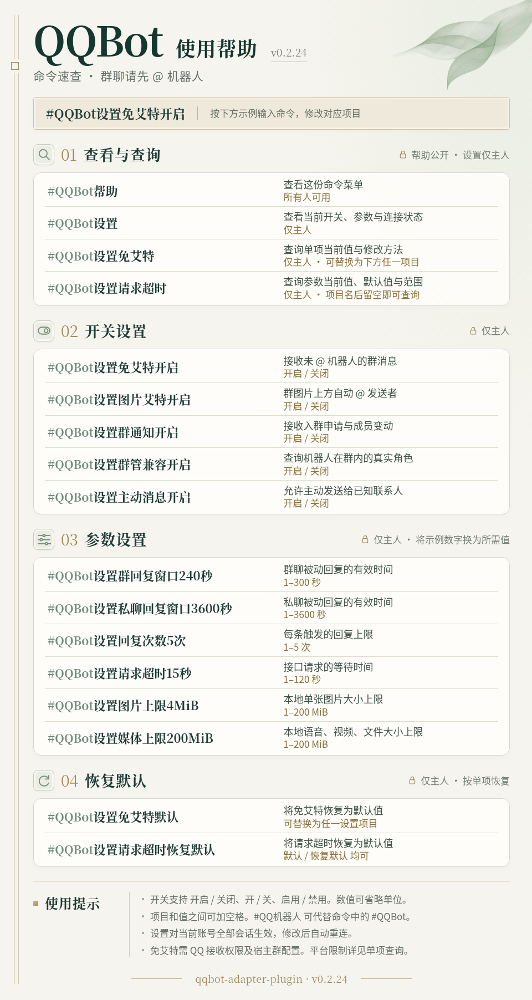
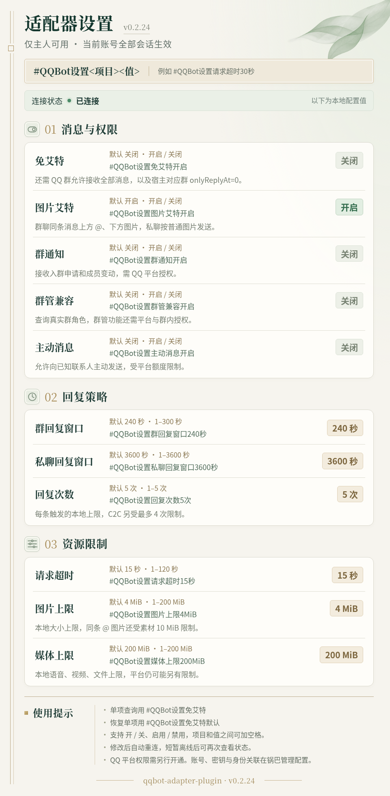

<div align="center">

# QQBot Adapter

**在 Miao-Yunzai 中使用 QQ 官方机器人**

群聊 / 私聊 · 图文媒体 · 命令设置 · 锅巴配置

[](package.json) [](https://github.com/yoimiya-kokomi/Miao-Yunzai) [](package.json) [](docs/CONFIGURATION.md#锅巴配置)

[安装](#安装) · [命令](#使用) · [预览](#效果预览) · [常见问题](#常见问题) · [文档](#文档)

</div>

`qqbot-adapter-plugin` 将 QQ 官方机器人的消息和事件接入 Miao-Yunzai，让业务插件通过 `e.reply`、`e.group`、`e.friend` 等接口处理群聊与 C2C 私聊。

**安装前请确认账号支持 WebSocket 接入。** 本版通过向外发起的 WSS / HTTPS 连接工作，账号需要具备对应的群聊或 C2C 场景权限。当前适配目标为 Miao-Yunzai 3.1.3，其他云崽分支及业务插件的兼容情况需分别核对。

## 功能

| 功能 | 可以做什么 |
| --- | --- |
| 群聊与私聊 | 接收群聊 @ 和 C2C 消息，按授权开启免 @、成员变动与入群申请事件 |
| 图文与媒体 | 回复文本、图片、语音、视频和文件，群图片支持同条消息上方 @、下方图片 |
| 交互与群管 | 接入 Markdown、按钮、图文卡片、引用、撤回及平台提供的群管理接口 |
| 帮助与设置 | 提供图片命令菜单、11 项聊天设置、当前值查询与单项恢复默认 |
| 锅巴配置 | 在管理页配置账号、连接、消息开关、主人授权与访问范围 |
| 身份与连接 | 按 AppID 和场景隔离身份，支持可信旧数据关联、心跳检测与断线重连 |

媒体、交互和群管的实际可用范围由账号权限、平台限制及业务插件调用方式共同决定。QQ 频道、完整聊天历史、头像查询、设置群管理员和名片暂未实现。详细范围见 [消息能力](docs/CAPABILITIES.md) 和 [群管理接口](docs/GROUP-ADMIN.md)。

## 安装

### 1. 准备环境

| 项目 | 要求 |
| --- | --- |
| 宿主 | 已能正常运行的 Miao-Yunzai 3.1.3 |
| 运行环境 | Node.js 24.x，使用 npm 安装本插件依赖 |
| QQ 机器人 | 在 QQ 开放平台创建，取得 AppID、AppSecret，并确认 WebSocket 与所需场景可用 |
| 平台配置 | 按账号要求设置服务器出口 IP 白名单、测试成员、沙箱及媒体权限 |
| 可选组件 | 锅巴提供图形化配置，FFmpeg 与 FFprobe 用于本地大视频处理 |

创建和管理机器人请使用 [QQ 开放平台](https://q.qq.com/)。本插件的连接采用出站请求。

### 2. 安装插件

在 **Miao-Yunzai 根目录**执行，安装分支为 `main`。

```sh
git clone --branch main https://github.com/XiaoyuBook/qqbot-adapter-plugin.git plugins/qqbot-adapter-plugin
cd plugins/qqbot-adapter-plugin
npm ci --omit=dev --ignore-scripts
npm run config -- --init
```

初始化会生成默认禁用的私有配置。Docker 环境需将插件目录、私有配置和业务数据持久挂载，并使用与喵崽进程一致的用户执行配置命令。

### 3. 配置账号

**终端配置**适合首次安装。在插件目录的本机或 SSH 交互终端执行，按提示填写 AppID 和隐藏输入的 AppSecret。

```sh
npm run config -- --enable
```

凭据保存到 `private/account.json`，在下次加载插件时生效。密钥通过交互提示输入，空输入保留已有密钥，切换 AppID 时需重新填写。

**锅巴配置**适合日常管理。喵崽加载插件后，在锅巴插件列表中打开「QQ 官方机器人适配器」，填写账号、启用连接并保存。保存后适配器会重新加载连接。

主人授权使用当前 AppID 下的原始 OpenID，群聊填写 `masterGroupOpenids`，私聊填写 `masterC2COpenids`。管理员应先核实身份，再分别授权。配置路径、字段、身份确认方法和密钥保管说明见 [配置指南](docs/CONFIGURATION.md)。

### 4. 首次使用

按现有启动方式启动或重新加载喵崽，确认插件加载、连接状态为 `online`，并收到 `heartbeat_ack`。

在已授权的群聊中 **@ 机器人**后发送 `#QQBot帮助`，或在已开通的 C2C 会话直接发送该命令。收到帮助后，已授权主人可以发送 `#QQBot设置` 查看配置。

## 使用

### 帮助、查询与恢复

| 命令 | 用途 | 权限 |
| --- | --- | --- |
| `#QQBot帮助` | 查看命令速查图 | 所有人 |
| `#QQBot设置` | 查看全部设置与连接状态 | 主人 |
| `#QQBot设置请求超时` | 查询单项当前值、默认值及取值范围 | 主人 |
| `#QQBot设置请求超时默认` | 将这一项恢复为默认值 | 主人 |

帮助也支持 `#QQ机器人帮助`、`#QQBothelp`。设置总览也可用 `#QQBot设置帮助`、`#QQBot设置列表`。查询和恢复命令中的项目名可替换为下表任意一项。

### 修改设置

所有修改命令均需主人权限，作用于**当前适配器账号的全部会话**。设置发生变化后，机器人会先回复保存结果，再重新加载连接。

| 项目 | 命令示例 | 默认值 | 取值 |
| --- | --- | --- | --- |
| 免艾特 | `#QQBot设置免艾特开启` | 关闭 | 开启 / 关闭 |
| 图片艾特 | `#QQBot设置图片艾特开启` | 开启 | 开启 / 关闭 |
| 群通知 | `#QQBot设置群通知开启` | 关闭 | 开启 / 关闭 |
| 群管兼容 | `#QQBot设置群管兼容开启` | 关闭 | 开启 / 关闭 |
| 主动消息 | `#QQBot设置主动消息开启` | 关闭 | 开启 / 关闭 |
| 群回复窗口 | `#QQBot设置群回复窗口240秒` | 240 秒 | 1–300 秒 |
| 私聊回复窗口 | `#QQBot设置私聊回复窗口3600秒` | 3600 秒 | 1–3600 秒 |
| 回复次数 | `#QQBot设置回复次数5次` | 5 次 | 1–5 次 |
| 请求超时 | `#QQBot设置请求超时15秒` | 15 秒 | 1–120 秒 |
| 图片上限 | `#QQBot设置图片上限4MiB` | 4 MiB | 1–200 MiB |
| 媒体上限 | `#QQBot设置媒体上限200MiB` | 200 MiB | 1–200 MiB |

- 开关也接受「开 / 关」「启用 / 禁用」。
- 数值使用整数，可省略单位。带单位时使用该项对应的「秒」「次」或「MiB」，MiB 大小写均可。
- 项目和值之间可加空格。「默认」「恢复默认」均可恢复单项。
- `#QQ机器人` 可代替 `#QQBot`，`免@`、`图片@` 分别是对应项目的别名。

免 @ 还需平台和群内接收授权，以及喵崽对应群 `onlyReplyAt=0`。C2C 回复另受最多 4 次限制，同条 @ 图片还受单张 Markdown 素材 10 MiB 限制。各设置的作用及配置字段见 [配置指南](docs/CONFIGURATION.md#聊天设置对应字段)。

### 效果预览

以下为 v0.2.24 使用默认配置生成的示例。运行时会显示当前版本、设置值和连接状态，可点击图片查看原图。

<table>
  <tr><th>帮助菜单</th><th>设置总览</th></tr>
  <tr>
    <td valign="top"><a href="docs/images/help.png"></a></td>
    <td valign="top"><a href="docs/images/settings.png"></a></td>
  </tr>
</table>

## 常见问题

### 群里发送命令没有反应

先 @ 机器人发送 `#QQBot帮助`，依次检查连接、平台测试成员与场景授权、本地群白名单，以及宿主的群消息过滤规则。启用免 @ 时，还需同时满足 `receiveGroupMessages=true`、QQ 群允许接收全部消息和宿主对应群 `onlyReplyAt=0`。接收授权说明见 [消息能力](docs/CAPABILITIES.md#授权与配置)。

### 能看帮助，但不能修改设置

QQBot 会话内的主人权限来自本插件的 OpenID 授权。请分别核对群聊 `member_openid` 和私聊 `user_openid`，以及当前 AppID。群主、群管理员和旧 QQ 数据关联各有独立用途，主人配置方法见 [主人与访问范围](docs/CONFIGURATION.md#主人与访问范围)。

### 帮助返回了文字

宿主渲染不可用、图片发送失败或本地图片上限不足时，会返回文字帮助。可检查宿主 Puppeteer / Chromium 是否可用、插件图片资源是否完整，以及 `maxImageBytes` 的设置。

### 图片、按钮或群管提示权限不足

按返回的错误码检查账号权限、群内授权、媒体或 URL 限制。群管开关用于查询机器人在群内的真实角色，具体管理操作仍需相应授权。图片排版、按钮降级与群管条件分别见 [消息能力](docs/CAPABILITIES.md) 和 [群管理接口](docs/GROUP-ADMIN.md)。

### 视频发送失败，或客户端显示为文件

本地大于 30 MB 的视频会先尝试压缩，需要 FFmpeg（含 libx264、AAC）和 FFprobe。HTTPS 视频由 QQ 平台拉取，需提供符合平台要求的 MP4。处理过程、大小限制与客户端显示条件见 [视频发送](docs/CAPABILITIES.md#视频发送)。

### 原有插件或 QQ 数据如何复用

业务插件需要支持字符串身份、按事件选择账号，并正确处理适配器回执。管理员可将已核实的身份关联到既有 QQ 数据，群聊与 C2C 分别配置。接口约定与关联流程见 [公共接口](docs/PUBLIC-CONTRACTS.md) 和 [身份与数据关联](docs/IDENTITY.md)。

## 更新与卸载

更新前安全保留私有配置，停用适配器并安排维护时间。确认插件工作区干净后，在 **Miao-Yunzai 根目录**执行以下命令，随后按现有方式重新加载喵崽并确认连接。

```sh
cd plugins/qqbot-adapter-plugin
git pull --ff-only origin main
npm ci --omit=dev --ignore-scripts
```

存在本地修改时，先核对差异并处理。重要环境可先在隔离副本运行 [验证检查](docs/VALIDATION.md#执行检查)。已有业务兼容补丁的版本要求和移除条件见 [补丁说明](docs/PUBLIC-CONTRACTS.md#已有业务兼容补丁的归属)。

卸载时先禁用连接，在维护时间停止喵崽，将整个插件目录移到 `plugins` 目录之外，再启动宿主。私有配置和业务数据单独保留，回滚时使用已核对的插件版本。

## 插件开发

在业务插件的事件处理器中使用当前事件的账号和联系人。

```js
await e.reply('文字回复')
await e.reply(segment.image(pngBuffer))
await e.group?.sendMsg('群聊回复')
await e.friend?.sendMsg('私聊回复')

const receipt = await e.reply('需要确认结果的回复', false, { receipt: true })
if (receipt && receipt.ok) {
  // 本次调用的所有内容段均已收到成功消息 ID。
}
```

账号入口为 `e.bot` 或 `Bot[e.self_id]`。第三参数支持 `at`、`recallMsg`、`button/keyboard` 和 `receipt`，包装 `e.reply` 时应继续传递这些选项。部分发送成功时会返回 `ok=false,status=partial`，其中 `message_ids` 保留已成功的消息 ID，调用方应按 `ok` 判断完整结果。完整规则见 [公共接口基线](docs/PUBLIC-CONTRACTS.md)。

### 本地检查

```sh
npm ci --ignore-scripts
npm test
npm run fixtures
npm run test:contracts
npm run test:host
npm run check
npm audit --omit=dev
```

`fixtures` 下载固定公开源码并校验 SHA256，也可通过 `npm run fixtures -- --from-host <源码快照目录>` 导入本地副本。自动测试使用隔离数据，宿主测试的来源、覆盖范围和运行方法见 [验证说明](docs/VALIDATION.md)。

## 文档

| 文档 | 内容 |
| --- | --- |
| [配置指南](docs/CONFIGURATION.md) | 私有文件、锅巴、主人与白名单、聊天设置字段 |
| [消息能力](docs/CAPABILITIES.md) | 消息格式、图片排版、按钮、视频与平台限制 |
| [群管理接口](docs/GROUP-ADMIN.md) | 群角色、通知、管理操作与授权 |
| [身份与数据关联](docs/IDENTITY.md) | OpenID、旧数据关联及离线迁移工具 |
| [公共接口基线](docs/PUBLIC-CONTRACTS.md) | 事件、联系人、回复选项、回执及兼容边界 |
| [验证说明](docs/VALIDATION.md) | 环境、检查命令与覆盖范围 |
| [开发路线](docs/ADAPTER-ROADMAP.md) | 适配器后续开发方向 |
| [第三方说明](THIRD_PARTY.md) | 参考来源、依赖与测试源码说明 |

平台资料可查阅 [QQ 机器人文档](https://bot.q.qq.com/wiki/) 和 [官方文档仓库](https://github.com/tencent-connect/bot-docs)。

## 反馈

请在 [Issues](https://github.com/XiaoyuBook/qqbot-adapter-plugin/issues) 提供插件版本、Node.js 与宿主版本、群聊或 C2C 场景、复现步骤、预期结果和脱敏错误码。涉及其他插件时，附上其名称和版本。

提交前移除 AppSecret、Token、Cookie、原始 OpenID、私有配置和用户聊天数据。

## 许可证

项目许可证尚未选定，当前 `package.json` 标记为 `UNLICENSED`。参考来源、运行依赖及测试用公开源码的许可证信息见 [第三方说明](THIRD_PARTY.md)。
